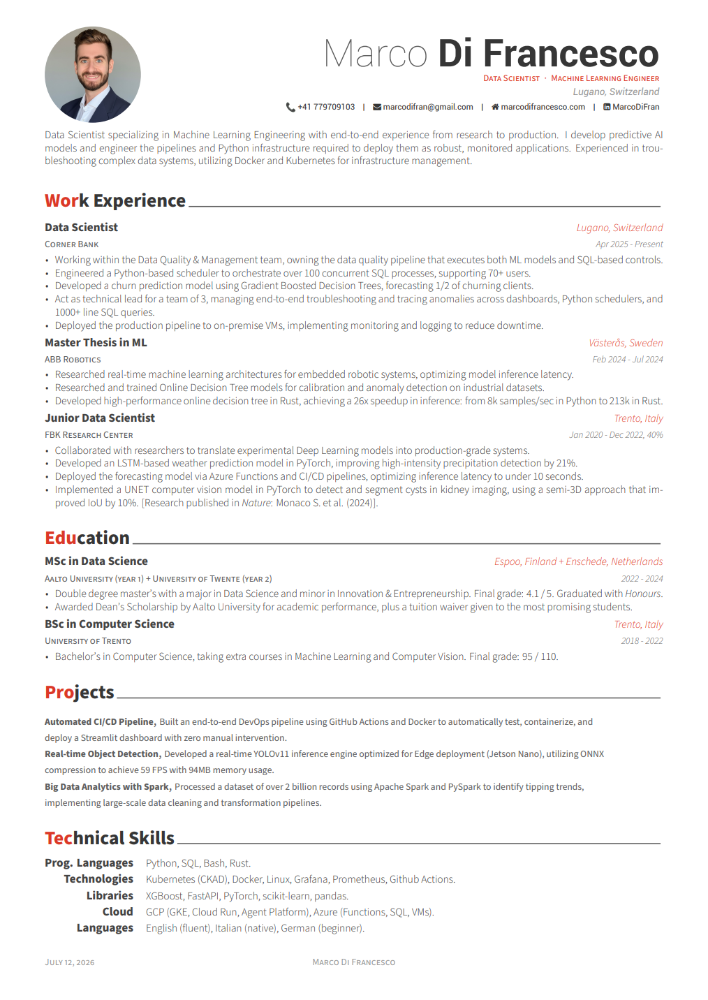
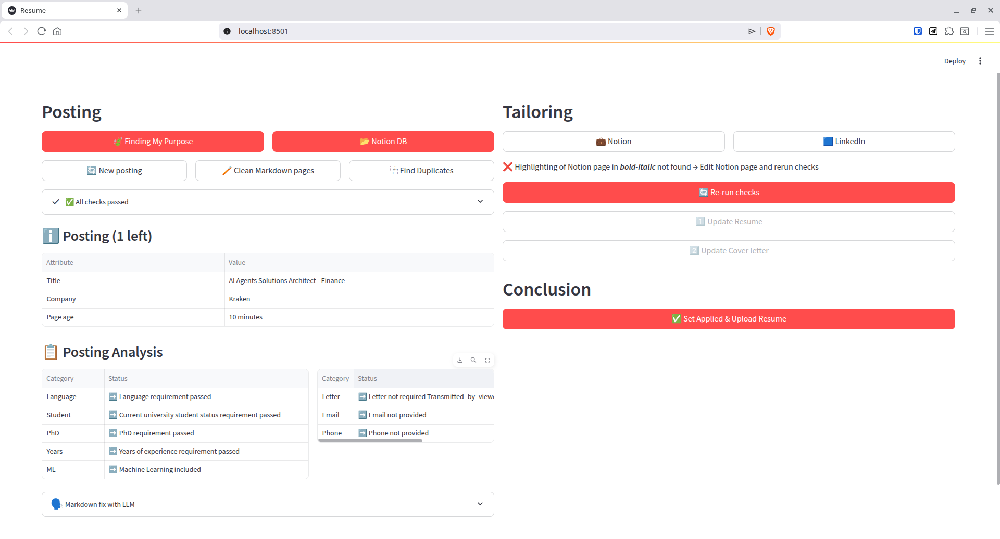

# Resume

This repository contains my LaTeX resume and a Python automation tool to manage the job application workflow with Notion, including running experience requirement checks, and optionally tailoring the resume using LLMs.

**Python version: 3.12**

## Latex

The source code for the core resume and cover letter.

To compile the resume manually from the command line, run the following commands:

```bash
cd latex
lualatex -output-directory=build resume.tex
```

The generated PDF will be located at `latex/build/resume.pdf`.

<div align="center">
  <kbd>
    
  </kbd>
</div>

## Streamlit

A local web application that connects to Notion to manage the application workflow. It helps track job postings, perform pre-application checks, and optionally use AI to tailor LaTeX resume sections.

1. **Install dependencies:**
   ```bash
   python3.12 -m venv .venv
   source .venv/bin/activate
   pip install -r requirements.txt
   ```

2. **Run the application:**
   ```bash
   source .venv/bin/activate
   streamlit run main.py
   ```
   *(Note: The app loads variables from your `.env` file.)*

<div align="center">
  <kbd>
    
  </kbd>
</div>
