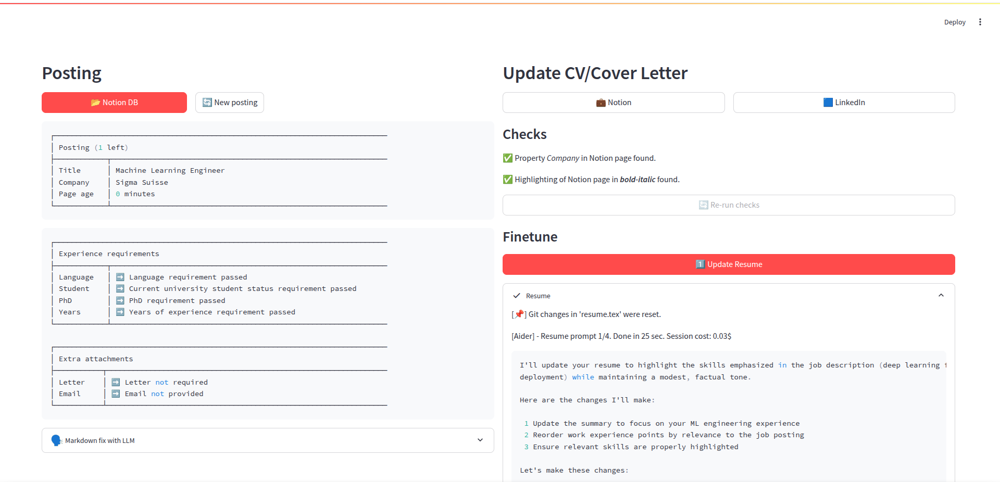

# Resume Finetune

**Python version: 3.12**

## Running the App

1. **Install dependencies:**
   ```bash
   python3.12 -m venv .venv
   source .venv/bin/activate
   pip install -r requirements.txt
   ```

2. **Run the application:**
   ```bash
   source .venv/bin/activate
   streamlit run main.py
   ```
   *(Note: The app automatically loads variables from your `.env` file.)*



## Compiling LaTeX

**Automatic Compilation:**
If you are using an IDE extension like LaTeX Workshop for VS Code, compiling is usually handled automatically on save. Make sure your root file is set to `latex/resume.tex` and that your tool chain is configured to output to the `build/` directory relative to the latex folder.

**Manual Compilation:**
To compile the resume manually from the command line, run the following commands:

```bash
cd latex
lualatex -output-directory=build resume.tex
```

The generated PDF will be located at `latex/build/resume.pdf`.
